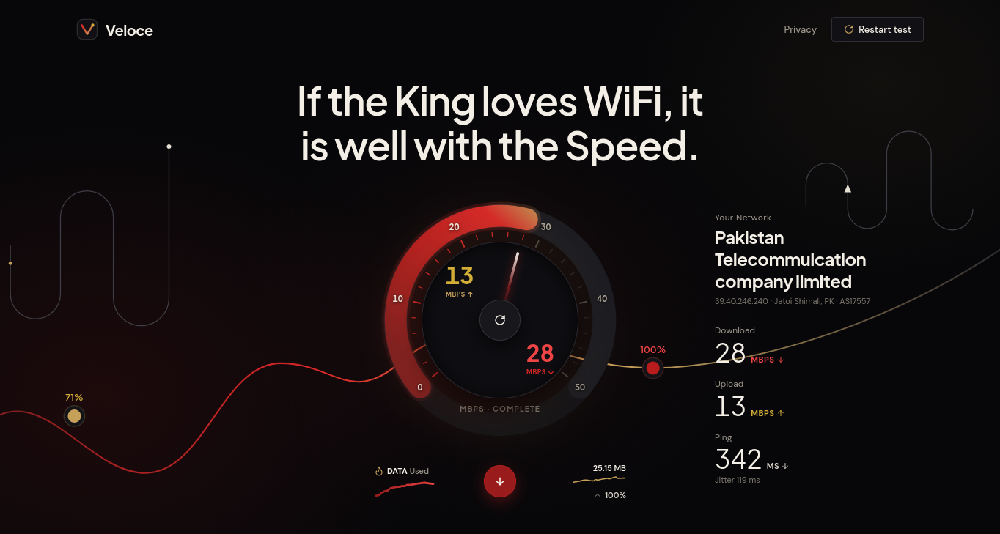

# Veloce

<p align="center">
  
</p>

<p align="center">
  <strong>High-precision internet speed test &amp; live network telemetry.</strong><br/>
  <sub>Noir Syndicate — obsidian · oxblood crimson · burnished champagne gold</sub>
</p>

<p align="center">
  
  
  
  
  
</p>

---

## Overview

Veloce is a high-precision internet speed test and real-time network telemetry web application. Built with the Next.js App Router, TypeScript, Tailwind CSS v4, and Motion, it measures download throughput, upload bandwidth, unloaded latency, loaded latency (bufferbloat), and connection jitter through a calibrated 260° speedometer interface in a dark **Noir Syndicate** palette — obsidian, smoked charcoal, oxblood crimson, burnished champagne gold, and warm ivory.

The test runs entirely in your browser against the app's own API routes. No third-party speed-test service is used, and configuration is stored locally only when "Save config for this device" is enabled.

## Features

- **Multi-phase speed test engine** — measures baseline round-trip ping and jitter, then parallel download streaming with sliding-window bandwidth smoothing and convergence detection, then upload throughput with concurrent loaded-latency sampling.
- **Calibrated 260° speedometer** — dynamic scale auto-ranging from 50 Mbps to 10 Gbps, 25 radial bezel graduations, live progress arcs, and a spring-damped needle synced 1:1 with real throughput. Center hub controls: Pause, Resume, Restart.
- **Live network & ISP telemetry** — server-side detection of client IP, ISP/organization, ASN, location, and browser link type via `/api/speedtest/info`, with customizable network labels.
- **Throughput sparklines & stability node** — crimson and champagne-gold SVG sparklines, a stability score node, and a progress indicator over a choreographed circuit-trace backdrop.
- **Detailed telemetry drawer** — Download, Upload, Unloaded Latency, Loaded Latency, Jitter, and Total Data Transferred. Includes Share summary copy, JSON telemetry export, Privacy modal, and a Settings panel (stream concurrency bounds, test duration, loaded-latency toggle).
- **Choreographed animations** — entrance line-drawing and spring animations across the header emblem, geometric traces, signal wave, bezel ticks, and telemetry columns, with `prefers-reduced-motion` support.

## Tech Stack

| Layer | Technology |
| --- | --- |
| Framework | Next.js 15 (App Router, API Routes) |
| Language | TypeScript 5.9 |
| UI & Styling | React 19, Tailwind CSS v4, Lucide Icons |
| Animation | Motion (`motion/react`) |
| Testing | Node built-in test runner (`node:test`) with `tsx` |

## Architecture

```text
app/
├── api/speedtest/
│   ├── download/route.ts   # Binary stream generator for parallel download tests
│   ├── upload/route.ts     # Payload ingestion endpoint for upload throughput
│   ├── ping/route.ts       # Low-overhead round-trip latency & jitter probe
│   └── info/route.ts       # Client IP, ISP, ASN, and geolocation lookup
├── globals.css             # Matte obsidian surfaces & Noir Syndicate radial glows
├── layout.tsx              # Font setup (Plus Jakarta Sans, DM Sans, JetBrains Mono) & metadata
└── page.tsx                # Application entry page
components/
├── FastSpeedTestApp.tsx    # Top-level test orchestration & view state
├── WieckerHeader.tsx       # Veloce emblem, Privacy trigger, and Restart control
├── WieckerBackdropCurves.tsx # Self-drawing geometric traces, signal wave & nodes
├── WieckerGauge.tsx        # Calibrated 260° SVG speedometer & center action hub
├── WieckerTelemetryRail.tsx # Network summary rail, sparklines & drawer toggle
├── WieckerSections.tsx     # Detailed telemetry drawer & network label editor
├── SettingsPanel.tsx       # Stream concurrency & duration configuration modal
└── InfoModal.tsx           # Privacy & methodology modal
hooks/
└── use-speed-test.ts       # Multi-phase HTTP speed test state machine
lib/
├── speedtest-math.ts       # Pure throughput, jitter, stability, sparkline & dial math
└── speedtest-math.test.ts  # Unit tests for core telemetry & gauge calibration math
```

## Getting Started

### Prerequisites

- Node.js 20+
- npm (or bun)

### Installation & Development

```bash
npm install
npm run dev
```

Open http://localhost:3000.

### Production Build & Linting

```bash
npm run lint
npm run build
npm start
```

### Unit Tests

```bash
npx --yes tsx --test lib/speedtest-math.test.ts
```

## API Routes

| Route | Method | Purpose |
| --- | --- | --- |
| `/api/speedtest/download` | GET | Binary stream generator for parallel download tests |
| `/api/speedtest/upload` | POST | Payload ingestion endpoint for upload throughput |
| `/api/speedtest/ping` | GET / HEAD | Low-overhead round-trip latency & jitter probe |
| `/api/speedtest/info` | GET | Client IP, ISP, ASN, and geolocation lookup |

## Topics

`speed-test` · `network-telemetry` · `bandwidth-monitor` · `latency` · `jitter` · `nextjs` · `react` · `typescript` · `tailwindcss` · `motion` · `dark-ui`

---

<p align="center">
  <sub>Built with Next.js · React · TypeScript · Tailwind CSS · Motion</sub>
</p>